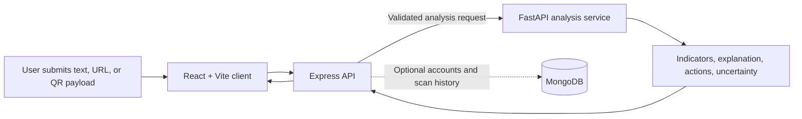

<div align="center">

# 🛡️ Digital Scam Prevention System

### Spot suspicious messages, links, and payment QR codes before you act.

An explainable, privacy-minded web application for reviewing digital scam signals and getting safer next steps.

[Features](#-features) · [How it works](#-how-it-works) · [Get started](#-get-started) · [API](#-api-at-a-glance) · [Security](#-security--privacy) · [Contributing](#-contributing) · [License](#-license)

<br />


</div>

---

> **Important:** DSPS is a decision-support tool, not a guarantee of safety or a substitute for professional advice. A low-risk result does not prove that a message, link, or payment request is safe. Verify unexpected requests through a trusted channel.

## ✨ Features

| Capability | What it does |
| --- | --- |
| 📨 Message review | Reviews SMS, WhatsApp, and impersonation text for suspicious signals. |
| 🔗 URL inspection | Examines URL structure without opening or fetching the destination. |
| 📷 QR analysis | Parses UPI payment payloads and offers a bounded image-decoding endpoint. |
| 🧭 Explainable results | Returns indicators, rationale, suggested actions, uncertainty, and provider status. |
| 👤 Accounts and history | Offers account registration, sign-in, and user-scoped scan history when MongoDB is configured. |
| 🧠 Baseline analysis | Uses a FastAPI analysis service with transparent rules; model training is an optional workflow and is not active in runtime. |
| 📱 Responsive interface | React and Vite dashboard for reviewing scans and summaries. |

## 🧩 How it works



The analysis response is heuristic and should not be interpreted as a calibrated probability of fraud. URLs are not fetched. Anonymous scan submissions are not persisted; account and history features require MongoDB.

## 🧰 Tech stack

- **Frontend:** React 18, Vite, React Router, Tailwind CSS, Recharts
- **API:** Node.js, Express, Zod, Helmet, rate limiting, Argon2, JWT cookies
- **Analysis:** Python, FastAPI, explainable baseline rules, URL and UPI parsing, QR image decoding
- **Data:** MongoDB with Mongoose for accounts and scan history
- **Local orchestration:** Docker Compose for API, analysis service, and MongoDB

## 🚀 Get started

### Prerequisites

- Node.js 20 or newer
- Python 3.12 or newer
- MongoDB 7 (optional for anonymous analysis; required for accounts and history)

### Local development

1. Copy `server/.env.example` to `server/.env`. Configure a MongoDB URI and two independent random JWT secrets. Copy `client/.env.example` to `client/.env` if the API is not available at `localhost:5000`.
2. Start the analysis service:

   ```bash
   cd ai-service
   python -m venv .venv
   # Activate .venv using the command for your shell
   pip install -r requirements.txt
   uvicorn app.main:app --reload --port 8000
   ```

3. In a second terminal at the repository root, install dependencies and start the API and web client:

   ```bash
   npm install
   npm run dev
   ```

4. Open [http://localhost:5173](http://localhost:5173). To start a local MongoDB container, run `docker compose up mongo` from the root.

Alternatively, start the API, analysis service, and database with `docker compose up --build`, then run the Vite client separately. Set a strong `JWT_ACCESS_SECRET` for anything beyond a throwaway local session.

If the API reports `EADDRINUSE` on port 5000, stop the previous API process or choose another `PORT` in `server/.env` and update the client's API base URL.

## 🔌 API at a glance

### Express API

| Method | Endpoint | Purpose |
| --- | --- | --- |
| `GET` | `/api/health` · `/api/ready` | Health and readiness checks |
| `POST` | `/api/auth/register` · `/api/auth/login` · `/api/auth/logout` | Account session actions |
| `GET` | `/api/auth/me` | Current account |
| `POST` | `/api/scans/{sms\|url\|qr\|whatsapp\|impersonation}` | Analyze a submitted item |
| `GET` | `/api/scans?page=1&limit=20` | List the signed-in user's scans |
| `GET` · `DELETE` | `/api/scans/:id` | Read or delete a scan |
| `DELETE` | `/api/scans` | Delete the signed-in user's scan history |
| `GET` | `/api/reports/summary` | Scan summary |

Scan requests accept JSON such as `{ "text": "..." }` or `{ "url": "..." }`.

### FastAPI analysis service

| Method | Endpoint | Purpose |
| --- | --- | --- |
| `GET` | `/health` | Service health |
| `POST` | `/analyze/{type}` | Analyze supported content |
| `POST` | `/analyze/qr-image` | Decode a QR image; multipart field `file`, PNG/JPEG/WebP, up to 5 MB |

Results can include a scan ID and type, score, risk level, detection method, indicators, explanation, actions, uncertainty/confidence, model version, provider status, and timestamp. Availability is reported explicitly.

## 🔐 Security & privacy

- Suspicious URLs are inspected without being opened or fetched.
- The application does not start payments. Never submit a UPI PIN, OTP, CVV, or bank password.
- QR images sent to the analysis endpoint are decoded in memory and are not retained.
- Authentication uses Argon2 password hashing and short-lived HttpOnly access cookies; scan history is scoped to its owner.
- Do not send private messages to external providers without clear consent. Review applicable data-retention requirements before deployment.

### Current limitations

Password reset, refresh-token rotation, email verification, admin workflows, PDF exports, and OCR are not implemented. The browser dashboard's QR upload flow is not connected yet; the analysis service endpoint can be used directly. External threat-reputation lookups are intentionally omitted. Automated unit, integration, and security tests and a production review remain outstanding. Do not treat this project as a complete production service until these gaps are addressed.

## 🧪 Model training

See the [training guide](ai-service/training/README.md) for the optional reproducible workflow. Use lawful, labeled data and preserve its provenance. Sample or train/test metrics are not evidence of real-world validated performance. The trained model is not currently active in the runtime analysis path.

## ☁️ Deployment notes

- **API:** deploy `server/` with Node.js; install dependencies and run `npm start`.
- **Analysis service:** deploy `ai-service/` with Python or Docker; run `uvicorn app.main:app --host 0.0.0.0 --port $PORT`.
- **Web client:** deploy `client/` with `npm run build`; publish `dist` and set `VITE_API_BASE_URL` to the backend `/api` URL.
- Set `AI_SERVICE_URL`, the exact `CLIENT_ORIGIN`, independent strong JWT secrets, and `COOKIE_SECURE=true` for HTTPS production deployments. Configure MongoDB credentials and network access with least privilege.
- Confirm `/api/health`, `/api/ready`, and `/health` after deployment. Free hosting may sleep, cold-start, limit memory, or use ephemeral storage.

## 🗺️ Project status

- [x] Responsive dashboard and five scanner routes
- [x] Express API and FastAPI baseline analysis
- [x] Authentication foundations and user-scoped scan history
- [x] URL and UPI analysis; bounded QR image decoding endpoint
- [x] Training workflow and deployment configuration
- [ ] Refresh-token rotation, password reset, and email verification
- [ ] OCR and connected browser QR upload
- [ ] Admin controls, false-positive reporting, and PDF exports
- [ ] Automated tests and production security review
- [ ] Configure deployed services and production credentials

## 🤝 Contributing

Contributions, bug reports, and documentation improvements are welcome. Before opening a pull request:

1. Describe the problem and the change you propose.
2. Keep privacy and explainability in mind; do not add URL fetching or external sharing without documenting the behavior and consent implications.
3. Update relevant documentation and disclose known limitations.
4. Never commit `.env` files, credentials, private user data, or model artifacts.

### Contributor

**Aayush Sharma** — project contribution and development.

## 📄 License

This project is licensed under the **Apache License 2.0**. See [`LICENSE`](LICENSE) for the full license text.

---

<div align="center">

Built to help people pause, inspect, and verify before they act.

</div>
